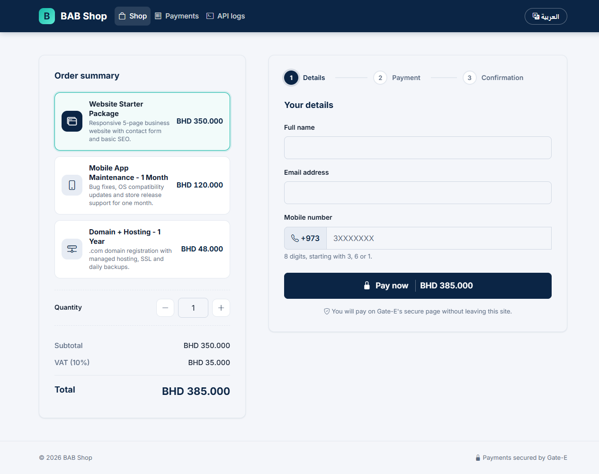
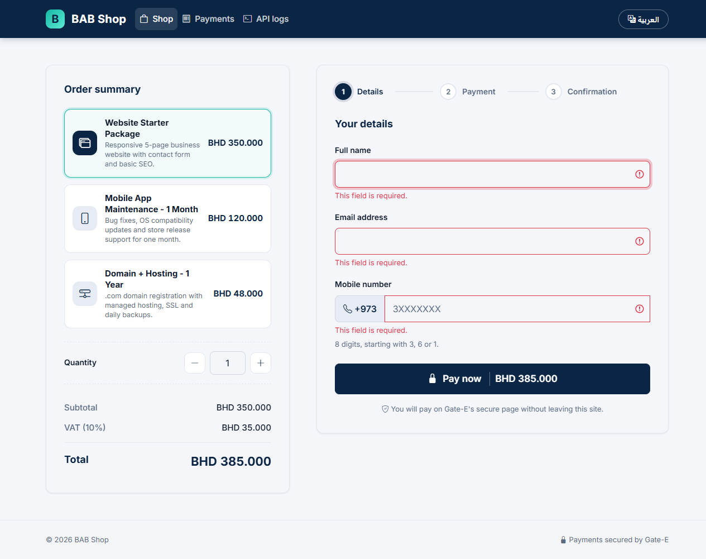
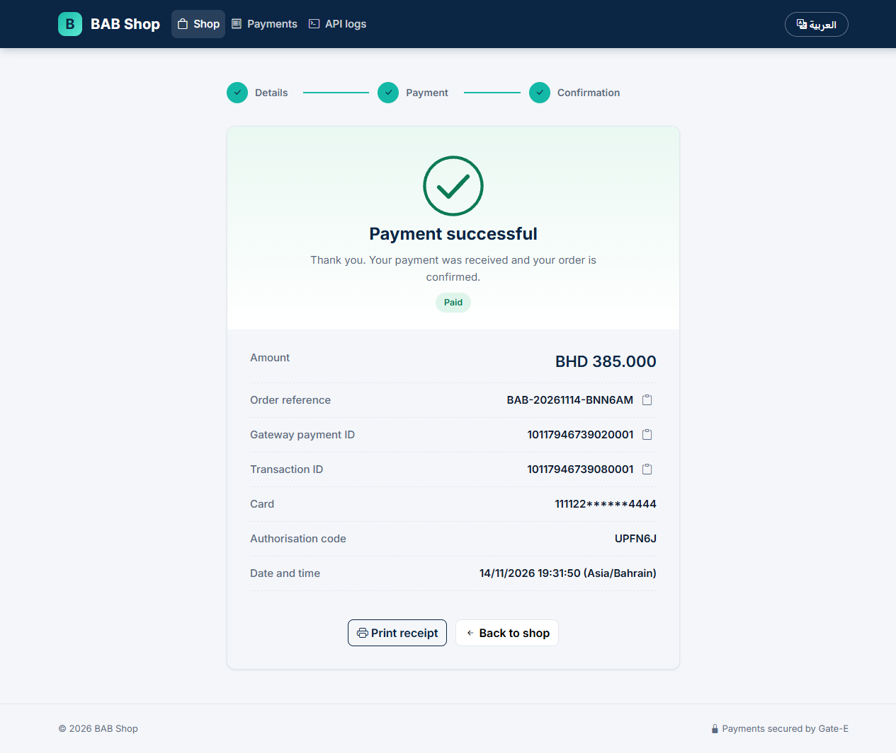
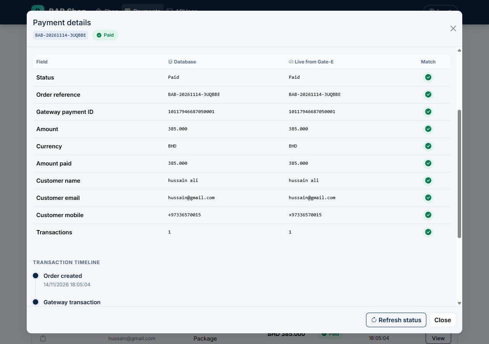

# Gate-E Checkout: BAB ALBAHRAIN technical assessment

A small shop where a customer picks a product, fills in their details and pays by card through Gate-E without leaving the checkout page. It is plain PHP 8.1 and MySQL (PDO) with Bootstrap 5, jQuery and AJAX, as the brief asked. Besides the seven tasks I added a few things I wanted in a real payment flow: status is always checked against the gateway, the callback can be refreshed safely, and there is an API log and an Arabic interface.



## Quick start

```bash
composer install
cp .env.example .env     # add the Gate-E credentials from the brief and your DB login
mysql -uroot < database/schema.sql
mysql -uroot < database/seed.sql
php -S localhost:8000 -t public
```

Open <http://localhost:8000>, pay with card `1111 2222 3333 4444`, expiry `12/30`, CVV `123` (success) or `999` (failure). Full setup, including the webhook tunnel, is further down.

| Page | URL | What you see |
|---|---|---|
| Checkout | `/` | Product form; the payment page opens in an iframe |
| Receipt | `/callback.php` | Result after paying (reached by the gateway redirect) |
| Payments | `/payments.php` | All payments, filters, **View** modal with DB vs live Gate-E data |
| API logs | `/logs.php` | Every request to Gate-E and every webhook |
| Arabic | `/?lang=ar` | Same pages in Arabic (RTL) |

## Requirements coverage

| # | Task from the brief | Where it lives | Screenshot |
|---|---|---|---|
| 1 | Gate-E integration with PHP and MySQL | `src/Gateway/GateEClient.php`, `src/Services/PaymentSyncService.php`, `database/schema.sql` | `09-api-logs.png` |
| 2 | Purchase form (name, email, mobile) stored in the DB | `public/index.php`, `src/Core/Validator.php`, `CustomerRepository` | `01-checkout.png`, `02-validation-errors.png`, `db-1-customers.png` |
| 3 | AJAX create-payment and an "initiated" DB record | `public/assets/js/checkout.js`, `public/api/create-payment.php`, `CheckoutService::start()` | `db-2-payments.png` |
| 4 | Payment page inside the same page (iframe, no redirect) | `#panel-pay` in `public/index.php`, `openGateway()` in `checkout.js` | `03-payment-iframe.png` |
| 5 | Redirect to a callback page; payment and transaction details updated | `public/callback.php`, `PaymentSyncService::syncFromGateway()` | `db-3-transactions.png` |
| 6 | Payment and transaction details on the callback page | `public/callback.php` (receipt card) | `04-callback-success.png`, `05-callback-failed.png` |
| 7 | Payments listing; "View" modal with DB and Gate-E data via jQuery AJAX | `public/payments.php`, `payments.js`, `api/payments-list.php`, `api/payment-details.php` | `06-payments-list.png`, `07-payment-modal.png`, `08-modal-comparison.png` |

## Extras

- The callback page, the webhook and the "Refresh status" button all use one sync class (`PaymentSyncService`).
- Statuses: `initiated`, `pending`, `paid`, `failed`, `cancelled`. Invalid changes such as `paid` to `failed` are rejected.
- Refreshing the receipt or a duplicate webhook does not create extra rows.
- The View modal compares the stored record with live Gate-E data and shows a match or mismatch badge.
- API log page with request, response, HTTP code and duration. The API key is masked.
- Dashboard cards on the payments page (total, paid, failed, success rate, revenue).
- Arabic and English with RTL layout, print stylesheet for the receipt, works down to 375px.

## Tech stack

| Layer | Technology |
|---|---|
| Backend | PHP 8.1+ (no framework), PDO, cURL, PSR-4 autoloading with Composer, `vlucas/phpdotenv` |
| Database | MySQL 8 (InnoDB, foreign keys, unique indexes, JSON columns for raw gateway responses) |
| Frontend | HTML5, CSS3, Bootstrap 5.3 (with the RTL build), JavaScript, jQuery 3, AJAX (JSON) |
| Payments | Gate-E REST API: payment create, get and gateway list, plus a webhook |
| Mobile (bonus) | Flutter 3 / Dart, `webview_flutter` |
| Tooling | Cloudflare Tunnel (public webhook URL), Mermaid (diagrams in this README) |

## Features

- Product purchase form with live totals, VAT and client plus server validation
- Gate-E payment page loaded in an iframe inside the same page, with a fallback link
- Callback receipt page and a background webhook, both verified against the gateway
- Payments listing with search, status and date filters, pagination and dashboard cards
- "View" modal comparing the stored record with live Gate-E data
- API log viewer with the API key masked
- Arabic and English with RTL, responsive layout, print stylesheet
- Flutter app that runs the same checkout in a WebView

## Project structure

```
public/                 Web root (php -S serves this)
  index.php             Checkout page
  callback.php          Redirect target / receipt
  payments.php          Payments listing + View modal
  logs.php              API log viewer
  api/                  AJAX endpoints (JSON)
  webhook/gate-e.php    Gate-E server-to-server notification
  assets/               CSS, JS (jQuery), images
src/
  Core/                 Env, Database (PDO), Csrf, Validator, Logger, RateLimiter, Lang, Response
  Gateway/              GateEClient (cURL), GatewayApi interface, StatusMapper
  Repositories/         Customer, Payment, Transaction, Product, ApiLog
  Services/             CheckoutService, PaymentSyncService, PaymentDetailsService
config/ lang/ views/    Settings, EN/AR strings, shared templates
database/               schema.sql, seed.sql
mobile/                 Flutter WebView app
docs/                   Architecture notes, API samples, screenshots
```

## Setup (about 5 minutes)

Requirements: PHP 8.1+ with `pdo_mysql`, `curl`, `mbstring`; MySQL 8; Composer.

```bash
composer install
cp .env.example .env          # then fill in the values below
mysql -uroot < database/schema.sql
mysql -uroot < database/seed.sql
php -S localhost:8000 -t public
```

`.env`:

```
APP_URL=http://localhost:8000          # the public URL once a tunnel is running
DB_HOST=127.0.0.1
DB_NAME=gatee_shop
DB_USER=root
DB_PASS=
GATEE_API_URL=https://api01.gate-e.net/
GATEE_API_USER=...
GATEE_API_KEY=...
GATEE_GATEWAY_ID=10117701907931638     # from gateway/list
```

**Tunnel for the webhook.** Gate-E cannot reach `localhost`, so the server-to-server notification needs a public URL:

```bash
cloudflared tunnel --url http://localhost:8000     # or: ngrok http 8000
```

Put the printed `https://...` address in `APP_URL`, restart the PHP server, and browse the app through that address. The customer redirect works on localhost too; only the webhook needs the tunnel.

Test card: `1111 2222 3333 4444`, expiry `12/30` (CVV results are listed under *How to use it*).

## How to use it

1. Open the checkout (`/`), choose a product and quantity, then enter name, email and a Bahraini mobile number (8 digits starting 1, 3 or 6).
2. Press **Pay now**. The payment is created through AJAX and the Gate-E card form opens inside the page.
3. Pay with the test card. The browser returns to the receipt page, which shows the result, amount, reference, transaction id and masked card.
4. Open **Payments** to see every attempt. Press **View** for the database record next to the live Gate-E data, and **Refresh status** to re-sync.
5. Open **API logs** to inspect each request, response and webhook.

| Test CVV | Result |
|---|---|
| `123` | Payment succeeds |
| `999` | Payment fails |
| any other | Gate-E lets the customer re-enter the card; nothing is recorded |

## Mobile app (bonus)

`mobile/` holds a small Flutter app that opens the same checkout in a WebView, with a progress bar, an offline retry screen and a URL allow-list. See [`mobile/README.md`](mobile/README.md) for how to run it on an emulator, a phone or Chrome.

## Screenshots

| | |
|---|---|
|  |  |
|  |  |
|  |  |
|  |  |

Database tables: [customers](docs/screenshots/db-1-customers.png), [payments](docs/screenshots/db-2-payments.png), [transactions](docs/screenshots/db-3-transactions.png), [api_logs](docs/screenshots/db-4-api-logs.png).

A sequence diagram of the payment flow is in [`docs/ARCHITECTURE.md`](docs/ARCHITECTURE.md).
