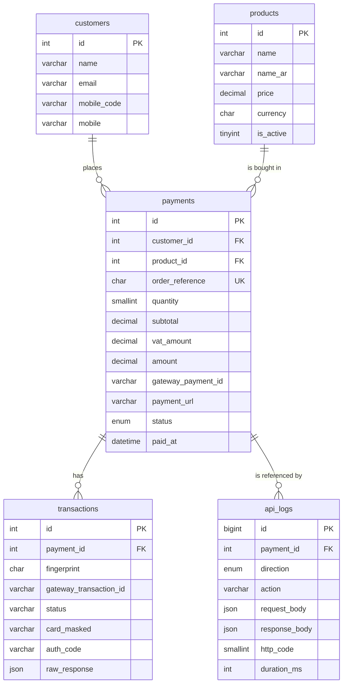
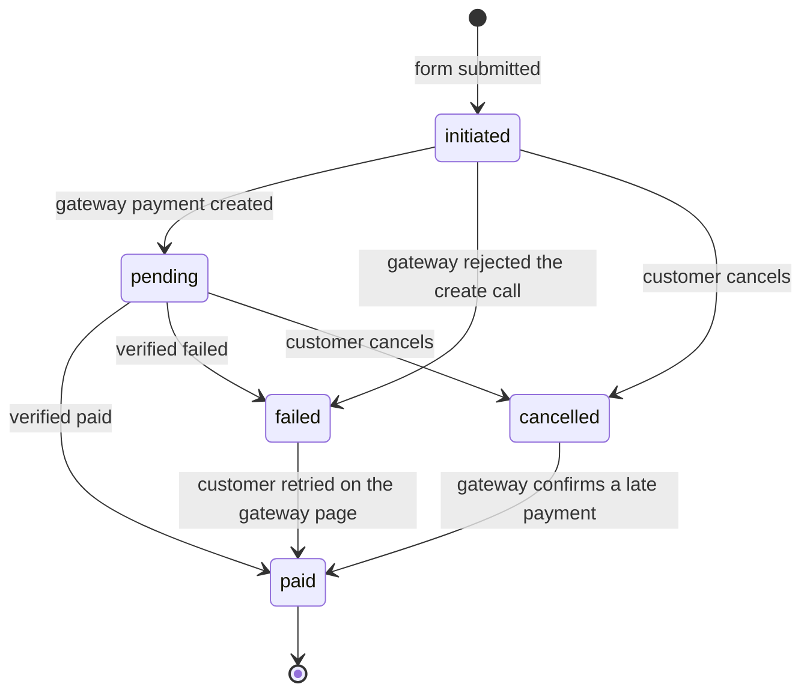

# Architecture

## Folder structure

```
bootstrap.php            autoload, .env, session, security headers, error handler
config/                  app.php, database.php (values come from .env)
lang/                    en.php, ar.php (one dictionary shared by PHP and JS)
views/                   partials (header, footer) and the 500 page
src/
  Core/                  Database, Env, Request, Response, Csrf, Validator, Logger,
                         RateLimiter, Lang, Signer, Container
  Gateway/               GatewayApi (interface), GateEClient, GateEException,
                         PaymentStatus (state machine), StatusMapper
  Repositories/          Product, Customer, Payment, Transaction, ApiLog
  Services/              CheckoutService, PaymentSyncService, PaymentDetailsService
public/
  index.php              checkout
  callback.php           receipt after the gateway redirect
  payments.php           listing, stats, details modal
  logs.php               API log viewer
  api/                   create-payment, cancel-payment, payment-details,
                         payments-list, refresh-status, stats, logs-list
  webhook/gate-e.php     server-to-server notification
  assets/                css (app.css, print.css), js (common, checkout, callback,
                         payments, logs), img
database/                schema.sql, seed.sql
docs/                    api-samples/, screenshots/, this file
storage/logs/            app.log
```

Dependencies point one way: `public` calls `Services`, services call `Repositories` and `GatewayApi`, nothing in `src` knows about HTTP pages.

## Data model



Amounts are `DECIMAL(10,3)` because the dinar has three decimals. `order_reference` (`BAB-YYYYMMDD-XXXXXX`) is unique. `transactions` has a unique key on `(payment_id, fingerprint)`, where the fingerprint is the gateway transaction id, or a hash of the payload if it has none.

## Payment status state machine



Any other transition is rejected by `PaymentStatus::canTransition()` and written to the log. The target status is always derived from a fresh `payment/get`.

## Sync flow (callback, webhook and Refresh status)

1. Load the local payment and call `payment/get` with the gateway id and order reference.
2. `StatusMapper::fromLive()` turns the response into one of the five statuses.
3. Open a DB transaction and `SELECT ... FOR UPDATE` the payment row.
4. Upsert every transaction from the response.
5. If the status changed, check the transition and, for `paid`, check that the gateway amount equals the order amount, then update.
6. Commit. A second run with the same data changes nothing.
